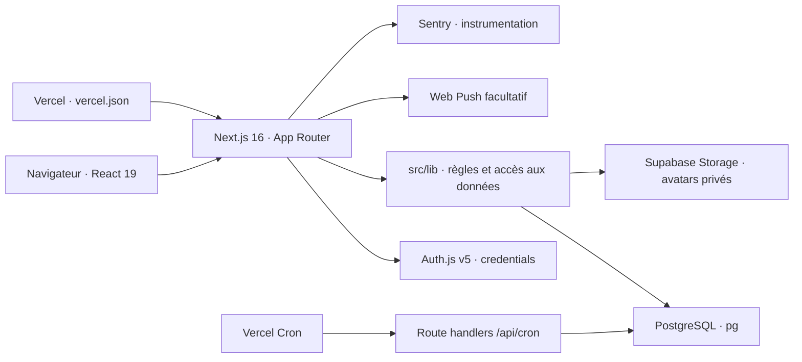
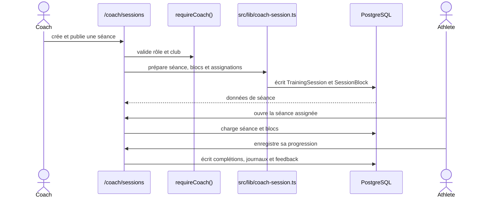
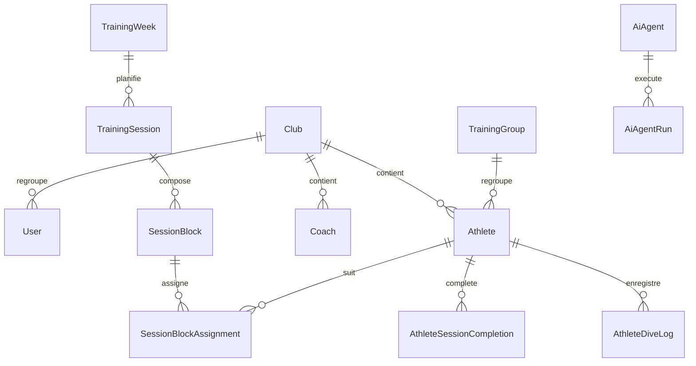
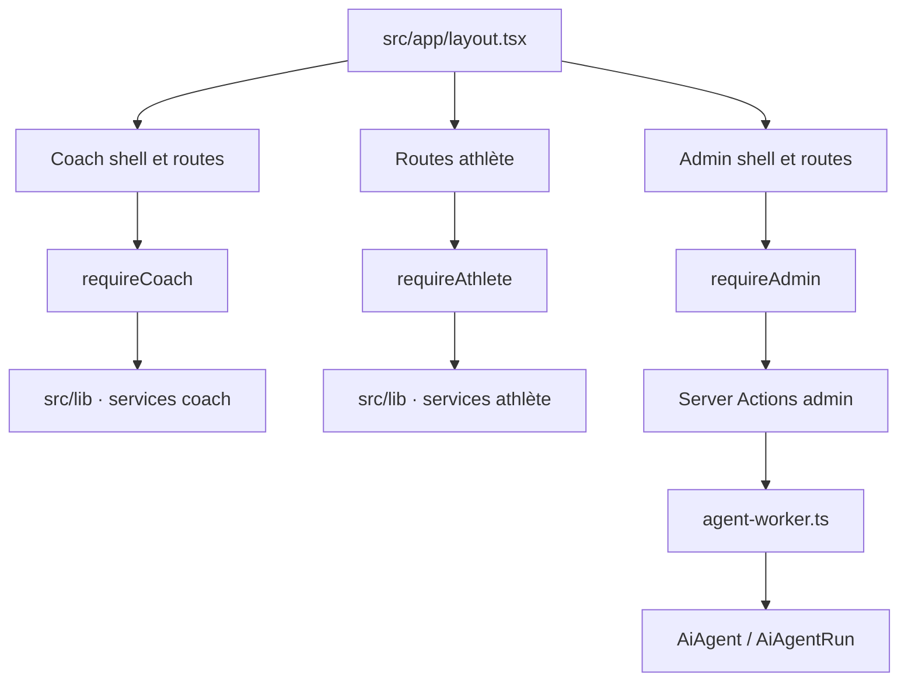

# Carte d’architecture DivePlan

> Référence : commit `09c79ca238dd02f3f7eac36bae052186e55ab773` · 2026-10-24 · dépôt local · périmètre : `src/app`, `src/lib`, `prisma/schema.prisma`, migrations Prisma et SQL, `vercel.json`, configuration Next et documentation versionnée. Carte initiale vérifiée dans le code. À mettre à jour avec l’Architecte-cartographe.

## Vue d’ensemble

DivePlan est une application Next.js App Router (React, TypeScript) servie par Vercel selon `vercel.json`. Les pages serveur et composants clients vivent dans `src/app`; les accès PostgreSQL et règles métier sont principalement dans `src/lib`. Auth.js v5 authentifie les rôles ADMIN, COACH et ATHLETE. PostgreSQL est accédé avec `pg`; Supabase Storage conserve les photos dans un bucket privé. Web Push est facultatif. Sentry est instrumenté, mais le dépôt ne connecte pas de consultation des événements Sentry à la console d’agents.

Sources : `src/app/`, `src/lib/db.ts`, `src/auth.ts`, `src/lib/current-user.ts`, `src/lib/avatar-storage.ts`, `src/lib/web-push.ts`, `src/instrumentation.ts`, `vercel.json`, `next.config.ts`.

## Modules et routes

- Coach : `/coach`, planning, séances, athlètes, groupes, bibliothèque, templates, monitoring et réglages. Sources principalement `src/app/coach/**` et `src/lib/coach-session.ts`, `src/lib/coach-pool-insights.ts`, `src/lib/session-template.ts`.
- Athlète : accueil, calendrier, semaine, player de séance, progression, compétences, profil et répétitions dorées. Sources `src/app/athlete/**`, `src/lib/athlete-session.ts`, `src/lib/athlete-progress.ts`, `src/lib/athlete-planning.ts`.
- Admin : `/admin`, accès coachs/utilisateurs, observabilité et `/admin/agents`. L’administration des agents est dans `src/app/admin/agents/**`; les traitements sont dans `src/lib/agent-worker.ts`.
- API : Auth.js `/api/auth/[...nextauth]`, progression `/api/athlete/session-progress`, suivi de progression coach, télémétrie transfert, Web Push, et crons de clôture des séances et exécutions d’agents. Inventaire vérifiable dans `src/app/api/**`.

## Parcours de séance

Le chemin exact varie selon la page et l’action; ce diagramme résume les frontières visibles et ne prouve pas le comportement en production. Voir `src/app/coach/sessions/`, `src/app/athlete/session/[id]/`, `src/app/api/athlete/session-progress/route.ts`, `src/lib/athlete-session.ts` et `prisma/schema.prisma`.

## Données principales

Le schéma est défini dans `prisma/schema.prisma`; des tables additionnelles/évolutions se trouvent dans `db/migrations/*.sql` et `prisma/migrations/*/migration.sql`. La base effective peut contenir des migrations non appliquées ou des objets créés hors dépôt.

## Composants, authentification et permissions

`src/app/layout.tsx` enveloppe les pages; les segments coach/admin utilisent leurs layouts et shells. Les pages serveur appellent `requireCoach`, `requireAthlete` ou `requireAdmin` de `src/lib/current-user.ts`. Les actions serveur doivent répéter la vérification d’accès. Les routes API valident leur session et leur ressource. La page `/admin/agents` et ses Server Actions sont réservées à ADMIN; le cron d’agents exige `CRON_SECRET` Bearer. Les opérations agent lisent le code et écrivent le résultat dans `AiAgentRun`; la file d’agent n’est pas un environnement d’exécution de code.

## Déploiement et services externes

`vercel.json` configure les crons quotidiens de clôture et de file agents. Le dépôt contient `next.config.ts` et les configurations Sentry. Vercel est le fournisseur indiqué par la configuration/documentation; les paramètres réels du projet, DNS, politiques de sécurité, sauvegardes et déploiement effectif ne sont pas lisibles dans le dépôt. Variables requises et sensibles décrites dans `README.md`; ne pas recopier leurs valeurs dans une cartographie. Les services externes repérés sont PostgreSQL, Supabase Storage, Web Push et Sentry. Aucun fournisseur LLM n’est configuré pour les rapports agents actuels.

## Limites et éléments à confirmer

- Les politiques RLS, rôles SQL de production, disponibilité des extensions et données réelles ne sont pas accessibles depuis le dépôt.
- La carte décrit les fichiers présents, pas les routes/relations actives d’un déploiement particulier.
- Vérifier les parcours et permissions par revue de chaque action et route; la présence d’un garde dans une page ne prouve pas celle dans tous ses appels.
- Les diagrammes sont résumés; les règles et cardinalités détaillées restent dans Prisma et les migrations.
- Le déploiement réel, les sauvegardes, la rétention, l’accès aux événements Sentry et les politiques Supabase restent à confirmer.
